# Item Finder

Item Finder is a RuneLite sidebar for looking up Old School RuneScape items while you play. Search the item list that is already in the game cache, then open one item for its crafting tree, monster drops, shops, Grand Exchange prices, high alch, and what you already own.

The plugin is written in Java 11 and built with Gradle, using the libraries already in the repository. It is licensed under the BSD 2-Clause License in `LICENSE`.

## Features

<table>
<tr>
<td align="center" valign="top">
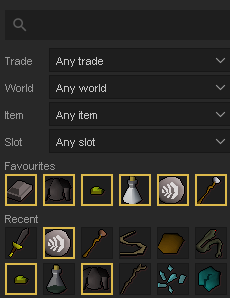<br>
Search and filters
</td>
<td align="center" valign="top">
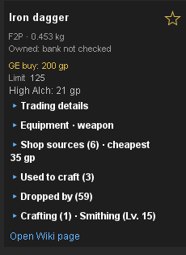<br>
Item detail
</td>
</tr>
</table>

- **Search and filters.** Type at least two characters. Filter by tradeable, members, equipable, and gear slot. Filters use the game cache. An empty or unmatched search says what was wrong. Favourites and the last viewed items stay in the sidebar.
- **Item detail pane.** Click a result to open the item. Sections start collapsed: Crafting, Shop sources, Dropped by, Used to craft, and equipment. Each header is one line with a count or a short summary. The drop header is the count, such as `Dropped by (59)`. Drag the divider to give the detail pane more or less of the sidebar.

- **Crafting tree and base materials.** A recipe shows the skill, level, facility, and experience. An ingredient that is itself crafted has an arrow. Rune essence, ores, logs, raw fish, herbs, shop stock, monster drops, and items gathered by Mining, Woodcutting, Fishing, Hunter, or Farming stay as leaves. One **Base materials** summary at the bottom lists what that recipe still needs. A requirement you do not meet is marked on the recipe line.

<table>
<tr>
<td align="center" valign="top">
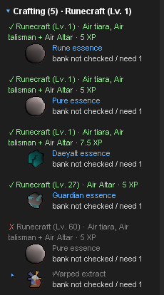<br>
Air rune crafting, including one unmet requirement
</td>
<td align="center" valign="top">
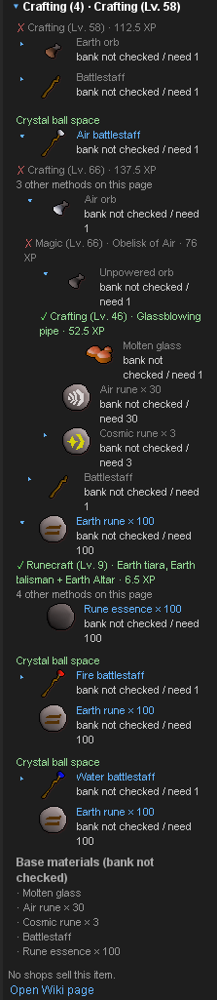<br>
Air battlestaff crafting tree, with one nested step and base materials
</td>
</tr>
</table>

- **Monster drops.** Quantity and rate. A rate the wiki states as a fraction, a percentage, Always, or a range is shown as `1/X`. Words such as Rare stay as written. Sort by rate, combat level, or name. Each row has an arrow and says "Click for locations".

<table>
<tr>
<td align="center" valign="top">
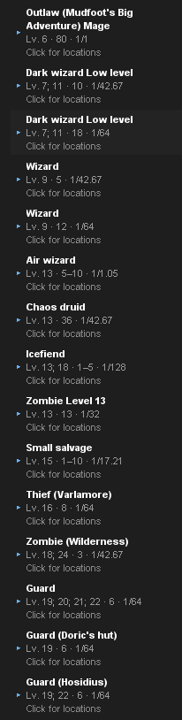<br>
Dropped by
</td>
<td align="center" valign="top">
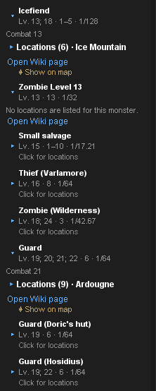<br>
Monster locations, combat level, wiki link, and Show on map
</td>
</tr>
</table>

- **Shops.** Shop name, price, and stock. The name opens the wiki page. **Show on map** is offered when the page has coordinates. The collapsed header includes the cheapest price.
- **Used to craft.** Lists items that use the open item as an ingredient, each as its own product. Iron dagger shows Iron dagger(p), Iron dagger(p+), and Iron dagger(p++). The Crafting section shows the recipes that produce the open item.

<table>
<tr>
<td align="center" valign="top">
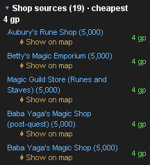<br>
Shop sources
</td>
<td align="center" valign="top">
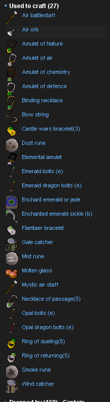<br>
Used to craft
</td>
</tr>
</table>

- **GE prices and high alch.** The guide price, the buy limit, and high alch stay visible. Instant sell, the post-tax margin, the 4-hour total, and alch profit sit under **Trading details**.

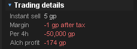

Trading details: instant sell, margin, the 4-hour total, and alch profit.

- **Owned counts.** Inventory and worn gear count immediately. The bank is included after you open it on that account. Until you open your bank, counts read "bank not checked".
- **Map pins.** **Show on map** places a pin for that shop or monster. Open the world map to see it. The pinned row says to open the world map. The latest pin is the one that stays. **Map pin color** defaults to hot pink, **Pin size** defaults to Medium, and the outline stays dark. Switching items removes the pins when **Clear pins on item switch** is on.

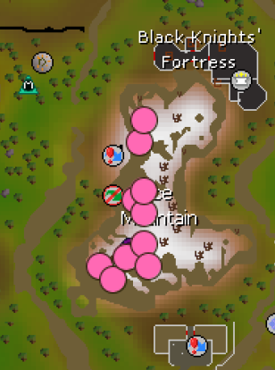

Map pins (Large pin size).

- **Detail sections.** Each one starts collapsed. Under **Default open sections** you can start Trading details, Equipment, Shop sources, Used to craft, Dropped by, Crafting, or Locations open when you switch items. Opening Dropped by shows the monster list from the item page. A monster row has an arrow and says "Click for locations". That click loads the monster. Locations, when set to start open, opens after that click. **Show high alch** hides the high alch row when it is off. **Right-click lookup** turns the menu entry on or off.
- **Item Browser Lookup.** Right-click an item in your inventory, bank (including placeholders and the bank inventory), worn equipment, the equipment stats interface, or on the ground, and choose **Item Browser Lookup**. Noted, placeholder, and worn items open the real item. The entry opens the item in this sidebar.

Ironman mode can list shops, drops, and crafting before Grand Exchange info. Auto follows the logged-in account. On and Off override that.

## How to use

1. Enable **Item Finder** from the Plugin Hub.
2. Open the sidebar. The button tooltip is **Item Finder**.
3. Type in the search box and set any filters. Results are icons.
4. Click an item, or right-click an in-game item and choose **Item Browser Lookup**.
5. Open a section header for the full list. Click an ingredient arrow for the next crafting step. Use **Show on map** when you want a pin, then open the world map yourself.

`IN_GAME_TEST_CHECKLIST.md` is the click-through for a logged-in client.

## Configuration

These are the names shown in the RuneLite config panel, under **Item Finder**. Saved settings stay with the account.

<table>
<tr>
<td align="center" valign="top">
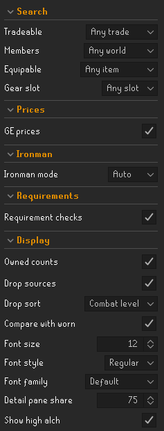<br>
Settings: search, prices, ironman, requirements, and display
</td>
<td align="center" valign="top">
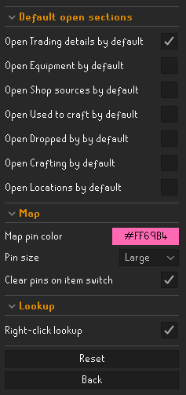<br>
Settings: default open sections, map, and lookup
</td>
</tr>
</table>

| Section | Setting | Default |
| --- | --- | --- |
| Search | Tradeable | Any trade |
| Search | Members | Any world |
| Search | Equipable | Any item |
| Search | Gear slot | Any slot |
| Prices | GE prices | On |
| Ironman | Ironman mode | Auto |
| Requirements | Requirement checks | On |
| Display | Owned counts | On |
| Display | Drop sources | On |
| Display | Drop sort | Rate |
| Display | Compare with worn | On |
| Display | Font size | 12 (10 to 22) |
| Display | Font style | REGULAR |
| Display | Font family | DEFAULT |
| Display | Detail pane share | 45 (25 to 75) |
| Display | Show high alch | On |
| Display | Wrap text | On |
| Display | Max recent items | 12 |
| Display | Show recent items | On |
| Display | Show animation items | Off |
| Display | Show task carry items | Off |
| Default open sections | Open Trading details by default | Off |
| Default open sections | Open Equipment by default | Off |
| Default open sections | Open Shop sources by default | Off |
| Default open sections | Open Used to craft by default | Off |
| Default open sections | Open Dropped by by default | Off |
| Default open sections | Open Crafting by default | Off |
| Default open sections | Open Locations by default | Off |
| Map | Map pin color | Hot pink |
| Map | Pin size | Medium |
| Map | Clear pins on item switch | On |
| Lookup | Right-click lookup | On |

**GE prices** warns that it sends your IP address to a server RuneLite does not control. The sidebar filters and the config choices stay in step with each other. **Max recent items** is 6, 12, 18, 24, 30, or 36 icons. **Show recent items** hides the Recent row and stops adding to it. The saved list stays. **Clear** on the Recent header removes that list. **Show animation items** and **Show task carry items** leave cutscene props and Sailing courier crates out of search. Favourites and Recent still list every saved item.

## Data sources & privacy

Search, tradeable and members flags, equipment slots, and high-alch values come from the game cache. Owned counts and requirement checks come from the logged-in client. Those paths stay off the wiki.

Wiki pages and Grand Exchange prices use RuneLite's injected OkHttp client and Gson. Every request sends this User-Agent:

`OSRS-Item-Browser (RuneLite plugin; +https://github.com/Vivialdi/osrs-item-browser)`

| What | Where | When | Cache |
| --- | --- | --- | --- |
| Item page (recipes, drops, shops, equipment, requirements) | `https://oldschool.runescape.wiki/api.php` with `action=parse`, `prop=wikitext\|text`, `redirects=true`, `maxlag=5` | Opening an item | 48 pages, 30 minutes |
| Monster or map wikitext | Same API with `prop=wikitext` only | Opening a monster, or **Show on map** when that page is not already loaded | 48 pages, 30 minutes |
| GE prices | `https://prices.runescape.wiki/api/v1/osrs/latest` | While **GE prices** is on, then again after 7 minutes, or when you press **Retry prices** | One snapshot for every item |
| Buy limits | `https://prices.runescape.wiki/api/v1/osrs/mapping` | While **GE prices** is on, then again after 24 hours, or from **Retry prices** | One list |

A 429, 503, other 5xx, or MediaWiki maxlag response schedules one retry on a background timer. A timeout or a dropped connection waits for the next request. Switching items cancels the previous item's calls. Requests leave out the player name, location, bank contents, and gear. **Item Browser Lookup** and **Show on map** change this sidebar and the world-map pin list.

## Building

Java 11. From the repository root:

```
gradle test
```

`gradle run` starts a client. Compile uses `-Xlint:deprecation`.

## Credits

Item data from the [OSRS Wiki](https://oldschool.runescape.wiki/) and the [OSRS Wiki prices API](https://prices.runescape.wiki/).
